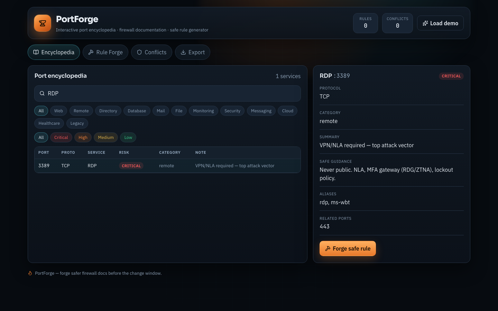
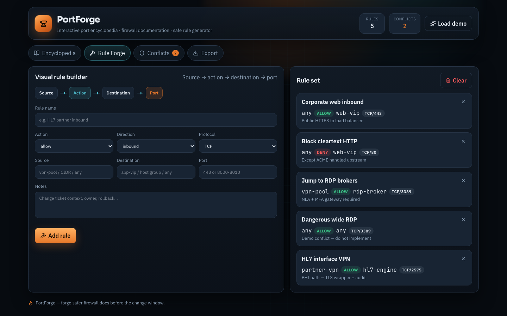
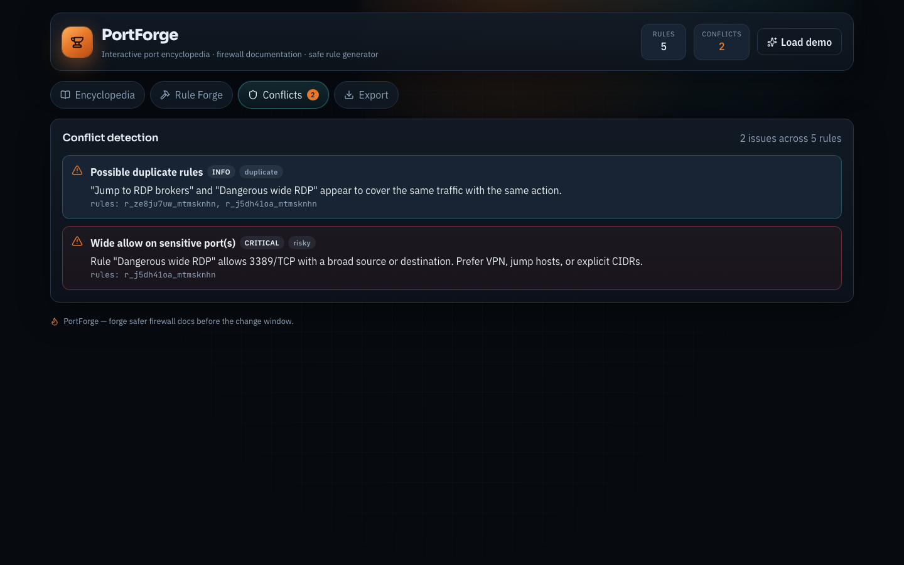
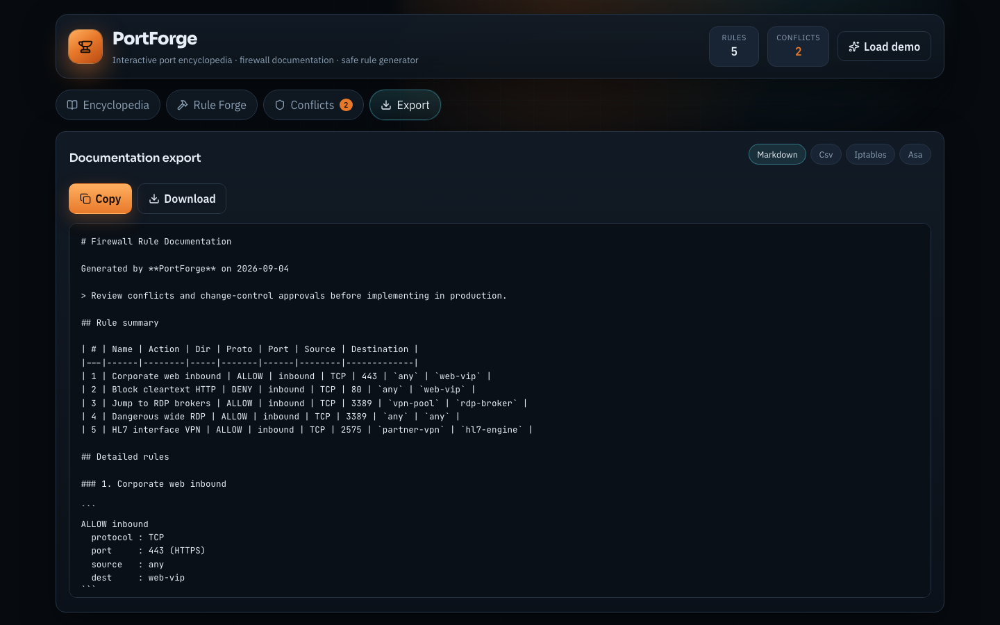
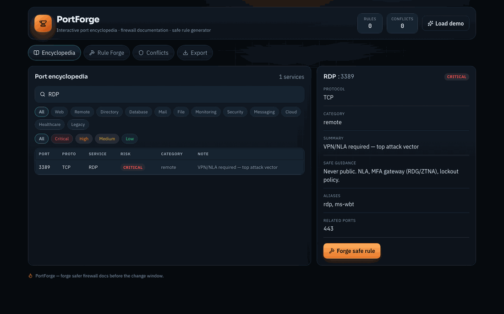

# PortForge

**Interactive port encyclopedia, firewall rule documentation builder, and safe rule generator for infrastructure teams.**

Stop googling “what port is LDAP” mid-ticket. Search a living port knowledge base, forge safe baseline rules, catch conflicts before CAB, and export docs your change packet will actually use.

PortForge extends [PortSignal](https://github.com/btstevens1984az/PortSignal) into a richer forge: searchable encyclopedia, visual rule builder, conflict detection, and multi-format export — React + TypeScript + Tailwind, with an optional FastAPI backend.

## Screenshots

| View | Preview |
|------|---------|
| Port encyclopedia |  |
| Rule forge |  |
| Conflict detection |  |
| Documentation export |  |

<p align="center">
  
</p>

## What it does

| Feature | Purpose |
|---------|---------|
| **Port encyclopedia** | 80+ TCP/UDP services with risk, category, aliases, related ports, and safe guidance |
| **Healthcare-aware entries** | HL7/MLLP, DICOM, and common clinical integration ports |
| **Search + filters** | Filter by port, service, risk, or category (web, remote, database, healthcare…) |
| **Visual rule forge** | Source → action → destination → port builder with safe baselines |
| **Conflict detection** | Duplicates, contradictions, overlaps, shadowing, and wide allows on sensitive ports |
| **Documentation export** | Markdown change docs, CSV, iptables sketches, ASA-style ACL sketches |
| **Local persistence** | Rule sets saved in browser `localStorage` |
| **Optional API** | FastAPI endpoints for ports, suggest, conflicts, and export |

## Run

### Frontend only (fastest)

```bash
git clone https://github.com/btstevens1984az/PortForge.git
cd PortForge/frontend
npm install
npm run dev
```

Open http://localhost:5173

### Frontend + FastAPI

```bash
# terminal 1 — API
cd PortForge/backend
python3 -m venv .venv
source .venv/bin/activate   # Windows: .venv\Scripts\activate
pip install -r requirements.txt
uvicorn main:app --reload --port 8788

# terminal 2 — UI
cd PortForge/frontend
npm install
npm run dev
```

API docs: http://127.0.0.1:8788/docs

### Docker (optional)

```bash
docker compose up --build
```

Open http://localhost:8788

### Linux

```bash
git clone https://github.com/btstevens1984az/PortForge.git
cd PortForge/frontend
npm install
npm run dev
```

### Windows

```powershell
git clone https://github.com/btstevens1984az/PortForge.git
cd PortForge\frontend
npm install
npm run dev
```

### macOS

```bash
git clone https://github.com/btstevens1984az/PortForge.git
cd PortForge/frontend
npm install
npm run dev
open http://localhost:5173
```

## Project structure

```
PortForge/
├── frontend/                 # React + TypeScript + Tailwind (Vite)
│   ├── src/
│   │   ├── App.tsx
│   │   ├── data/ports.ts     # Port encyclopedia
│   │   ├── hooks/            # Rule state + localStorage
│   │   └── lib/              # Conflict detection + exporters
│   └── public/
├── backend/                  # Optional FastAPI API
│   ├── main.py
│   ├── data/ports.json
│   └── requirements.txt
├── docker/                   # Combined serve helper
├── media/                    # Screenshots + GIF
├── docker-compose.yml
└── README.md
```

## Security & privacy

- Rule sets are stored in **browser localStorage** only (frontend mode)
- Export sketches are **documentation aids** — review and validate before applying on production firewalls
- Demo data uses generic labels (`vpn-pool`, `web-vip`, `hl7-engine`) — no real patient or enterprise inventory data

## License

MIT
